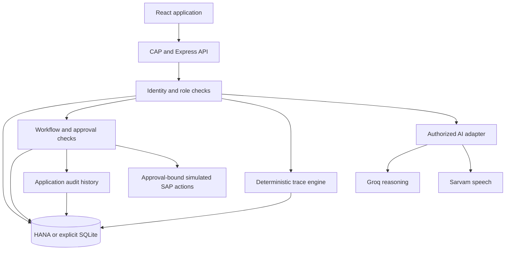

# ToolSathi V2.1

ToolSathi connects manufacturing issue reporting, equipment repair, product-exposure investigation and temporary workforce assignment in one application. Workers report problems through a multilingual conversation; managers review evidence and assign qualified technicians; technicians record repairs; independent verifiers control return to service.

**Stack: React + SAP CAP + SAP HANA Cloud + Groq + Sarvam AI.** The project has a working HANA-backed demonstration and an independent SQLite practice mode. Manufacturing records are synthetic. SAP S/4HANA and Digital Manufacturing business actions are explicitly **SIMULATED**, separately from the real HANA database connection.

**Start here:** [Windows setup](#windows-setup) · [Feature locations and roles](#feature-locations-and-roles) · [Voice conversation](#worker-voice-conversation) · [Repair assignment](#technician-assignment-repair-and-verification) · [Worker reassignment](#worker-reassignment-during-downtime) · [Tests](#testing-and-recorded-verification) · [Troubleshooting](#troubleshooting)

Implementation snapshot: **2 November 2026**, branch `feature/toolsathi-v2-core`. The [handover](docs/v2.1-handover.md) records acceptance boundaries. Record counts can change as people use the application.

## Features

| Feature | Implemented behavior | Location |
|---|---|---|
| Equipment identification | Loads the actual register; validates typed IDs and QR payloads against registered equipment | Worker intake and workspace |
| Typed reporting | Preserves original statements, edited descriptions, missing information and explicit confirmation | `/worker`, `/workspace` |
| Multilingual voice conversation | Sarvam STT, Groq contextual follow-up questions and Sarvam TTS; transcript correction before sending | Workspace voice panel |
| Structured AI intake | Suggests category and NC code from the stored catalogue; validates JSON and records provider/model provenance | Worker intake and conversations |
| Manager review | Retrieves original report/conversation evidence, requests information and reviews completed work | Workspace and console |
| Technician assignment | Checks equipment skills, certification, safety permission, work center, availability and workload | Assigned work |
| Repair lifecycle | Technician acceptance, findings and passing repair evidence; Manager review; distinct Verifier return check | Workspace and evidence console |
| Inventory and references | Compatible parts, persisted stock/reservations, actual use/release, repair history, calibration and SOP references | Technician workspace |
| Grounded repair guidance | Cited hypotheses/checks; absent approved procedures and tolerances remain explicit | Request grounded AI guidance |
| Duplicate review | Existing rules plus optional model comparison; human link/separate/reject decisions preserve original reports | Duplicate review |
| Repeat-failure review | Deterministic evaluation of stored incident and repair history | Console/history |
| Workforce reassignment | Identifies workers affected by unavailable equipment and eligible destination stations; Manager approval required | Workforce reassignment |
| Deterministic exposure trace | Recorded tool-use → production → batch → serial → inventory/shipment relationships; Confirmed, Probable and Unknown association | Evidence console |
| Investigation timeline | Stored report, verification, snapshot, batch and gap evidence | Evidence console |
| Containment approvals | Separate proposals, role-specific decisions and matching approval checks before simulated action | Evidence console |
| Recovery planning | Bounded read-tool planning using reviewed alternative-equipment evidence; approved execution remains simulated | Evidence console |
| Website assistant | Role-authorized records and retrieved knowledge, with sources; no write tools | Floating Website assistant |
| Multilingual communication | Reviewed-card readback, incident status text, trace explanations and approval-bound dealer drafts; a saved draft is not a sent message | Worker/console communication controls and APIs |
| Secure onboarding | Profiles for authenticated identities; privileged registration requires a bound invitation and matching provider role | Onboarding/Administration |
| Notifications | Persisted assignment/review/information notifications, retrieved on refresh | Workspace Notifications |
| Audit and history | Actor, role, action, reason, time and relevant evidence/provenance; append-only application audit history | Console and tool history |
| Executive evidence report | Downloadable HTML built from persisted evidence; browser Print/Save as PDF | Evidence console |
| Localization and UI | English, Hindi and Kannada resources; responsive glass-style industrial interface, keyboard controls and reduced-motion styling | Main pages |
| System status | Database connectivity separated from configured/verified AI providers and simulated SAP business services | Ribbon and System status |

There are **three separate assignment concepts**: repair assignment gives a technician responsibility for an incident; workforce reassignment moves qualified workers to another station during downtime; recovery planning recommends an equipment/operation response whose execution is simulated.

## Architecture and processing



The browser calls `/api` through Vite's local proxy. CAP transactions persist application changes. Groq receives bounded authorized context through the provider interface; Sarvam supplies transcription and speech. Source IDs are checked before generated guidance is accepted. AI cannot grant qualifications, approve actions or change trace results.

The trace engine is deterministic code. It follows recorded relationships and timestamps, deduplicates serials, identifies missing evidence and calculates association tiers. **Confirmed means a record-linked association, not a product-quality determination.** Products remain potentially exposed pending the appropriate investigation.

Tool state normally follows `Active → Restricted → Under repair → Awaiting verification → Active`. Work-order state follows `Assigned → Accepted → Submitted → Reviewed`. These records are distinct: assigning work does not restrict equipment, and Manager review does not independently authorize return to service.

| Layer | Technology |
|---|---|
| Browser | React 18, Vite 5, React Router 6, Framer Motion, CSS, bundled Kannada/Devanagari fonts |
| Server | Node.js 24, SAP CAP 10, Express 4, CDS queries and transactions |
| Database | `@cap-js/hana`; explicit development/test `@cap-js/sqlite` |
| AI/retrieval | Groq reasoning facade, existing Sarvam modules, Ajv validation, source chunking/versioning, optional multilingual embeddings and keyword fallback |
| Identity | XSUAA through `@sap/xssec`; named demo headers only in development |
| Verification | Jest/Supertest/CAP, Node frontend tests and Playwright browser integration |

```text
SAP_HACKFEST/
├── backend/                  Sole CAP project root
│   ├── db/schema.cds         35 application entities
│   ├── db/seed/              Original and namespaced synthetic datasets
│   ├── srv/server.js         Database configuration and router bootstrap
│   ├── srv/routes/           REST endpoints
│   ├── srv/lib/              Trace, authorization, workflow and AI integration
│   ├── srv/ai-adapter/       Existing teammate intake, speech and retrieval modules
│   ├── scripts/             Build, verification, backup and guarded HANA operations
│   ├── tests/               Regression tests and recorded results
│   ├── docs/openapi.yaml     API schema document
│   ├── mta.yaml              BTP deployment descriptor
│   └── xs-security.json      XSUAA scopes and role templates
├── frontend/src/            Screens, components, API client and feature panels
├── frontend/scripts/        Browser tests and localization tooling
├── scripts/dev.js           Combined application launcher
├── docs/                    Guides, acceptance evidence and API inventory
├── deploy/                  Deployment navigation
└── backup/                  Ignored backups and isolated demo databases
```

The implementation reuses Vinayaka's frontend, Shashank's AI/speech/retrieval modules and the integrated approval, duplicate, repeat-failure and repair logic. Optional original `srv/rules` modules are absent; the adapter uses documented fallback rules alongside the integrated workflow. The [integration audit](docs/v2-integration-inventory.md) records that main `10a6ff0` already included Shashank `6162563`, so no redundant merge was needed.

## Windows setup

Use **Node.js 24.11 or newer within major 24**, npm and a current browser. Microphone access requires permission and localhost or an HTTPS origin. Install frontend and backend dependencies separately; root dependency installation is unnecessary.

```powershell
Set-Location C:\Users\yoges\Desktop\hackfest\SAP_HACKFEST
npm --prefix backend ci
npm --prefix frontend ci
```

### Existing authorized HANA destination

```powershell
npm run dev:hana:v21
```

Open **http://localhost:5173/workspace**. API: **http://localhost:4004/api**. The launcher enables V2 workflows, keeps approvals enforced, and disables HANA startup seeding. **Ctrl+C** stops its two child processes. Occupied ports are reported without terminating existing applications.

This command requires private HANA configuration and the reviewed 35-table deployment. A fresh checkout does not provision a HANA account/database. For a new authorized destination, follow the [HANA setup guide](backend/docs/hana-cloud-integration.md) and [V2.1 deployment details](docs/v2.1-hana-integration.md).

### Independent SQLite practice mode

```powershell
npm run dev:v21
```

This creates a **new isolated SQLite file** in ignored `backup/`, with the original trace scenario and V2/V2.1 profiles, qualifications, parts and demand. Existing HANA and SQLite data remain intact. Local data access works without HANA; live AI still requires keys/network access.

| Root command | Behavior |
|---|---|
| `npm run dev:hana:v21` | Configured HANA, V2 enabled, no startup deployment/seed |
| `npm run dev:v21` | New isolated SQLite V2/V2.1 demonstration |
| `npm run dev:v2` | Alias using the same current isolated-demo launcher |
| `npm run dev` | Follow private database environment; does not force V2 enablement |
| `npm run dev:local` | Existing SQLite file, without automatic schema upgrade |
| `npm run dev:fresh` | New original SQLite trace demo, without V2/V2.1 fixture graph |
| `npm run dev:backend` | Backend-only existing SQLite startup |
| `npm run dev:frontend` | Frontend-only startup |

To use other free ports:

```powershell
$env:TOOLSATHI_BACKEND_PORT = "4010"
$env:TOOLSATHI_FRONTEND_PORT = "5180"
npm run dev:hana:v21
```

The combined launcher adjusts the proxy; open `http://localhost:5180/workspace` for this example. Stop the old launcher before changing modes.

### Configuration

Keep secrets in ignored `backend/.env` or deployment bindings. Preserve existing private settings. The [backend example](backend/.env.example) contains placeholders. Frontend variables are public browser configuration and must never contain database/provider secrets.

| Variable | Purpose |
|---|---|
| `DATABASE_MODE` | `hana` or `sqlite`; HANA failures never silently switch modes |
| `HANA_CONNECTION` | `direct` assigned SQL schema or existing CAP/HDI `binding` |
| `HANA_SQL_ENDPOINT` | SQL `hostname:port`, without HTTPS URL/path |
| `HANA_USER`, `HANA_PASSWORD`, `HANA_SCHEMA` | Dedicated application account and assigned schema |
| `HANA_TARGET_CONFIRMED` | Exact schema name after exclusive assignment is confirmed; not authorization by itself |
| `HANA_ENCRYPT`, `HANA_VALIDATE_CERTIFICATE` | Keep both `true` |
| `V2_WORKFLOW_ENABLED` | HANA V2 enablement after deployment; set by `dev:hana:v21` |
| `GROQ_API_KEY` | Backend-only reasoning credential |
| `GROQ_MODEL` | Optional active account-accessible model; otherwise active models are checked before selection |
| `AI_REASONING_PROVIDER` | Optional `groq` or `sarvam`; Groq is the default when its key exists |
| `SARVAM_API_KEY` | Backend-only speech/provider credential |
| `AUTH_MODE` | Development `header` or production `xsuaa` |
| `VITE_API_BASE_URL` | Browser API path, normally `/api` |
| `VITE_DEMO_AUTH` | Development demo controls, never production authorization |
| `VITE_AI_ENABLED` | Enable browser intake reasoning/voice; `false` does not disable every AI endpoint |

The [frontend example](frontend/.env.example) sets **`VITE_AI_ENABLED=false`**. If copied, enable it and restart Vite before testing voice. A temporary PowerShell override is:

```powershell
$env:VITE_AI_ENABLED = "true"
npm run dev:hana:v21
```

The last verified Groq model was `openai/gpt-oss-120b`, an observation from the configured account. Provider errors distinguish configuration, authentication, model access, rate limits, timeout and invalid output.

## Feature locations and roles

| Page | Purpose |
|---|---|
| `/` | Landing screen and navigation |
| `/workspace` | Voice/typed conversations, onboarding, technician work, Manager assignment, duplicates, workforce and system status |
| `/worker` | Original equipment identification and incident-card reporting |
| `/console` | Traces, evidence, approvals, repair/verification, recovery and executive report |
| `/history` | Stored tool history, duplicate and repeat-failure review |
| `/kitchen` | UI component/design showcase |

The floating **Website assistant** appears across pages. The top-bar language selector controls interface/assistant language; the older Worker intake also has a reporting-language selector. Original report statements remain unchanged.

In development, expand **Demo mode** in the top bar to show roles and **Local demo user ID**. These are named demonstration identities, not a password-based login.

| Backend role | Visible label | Responsibility | Seed identity |
|---|---|---|---|
| Worker | Assembly Worker | Own reports, confirmation and information responses | `V21-WORKER-01` |
| Manager | Plant Manager | Review, technician assignment, repair review, workforce approval | `V21-MANAGER` |
| Technician | Metrology Specialist | Assigned work, repair findings/evidence and parts | `V21-TECH-1` or `V21-TECH-2` |
| Quality | Quality Lead | Exposure review and quality/stock containment decisions | `V21-QUALITY` |
| Verifier | Verifier | Independent passing-repair/return checks | `V21-VERIFIER` |
| Administrator | Administrator | Privileged invitations, qualifications, policies/parts and provider checks | `V21-ADMIN` |

Production requires verified XSUAA identity and matching scopes. Registration creates an application profile, not a provider account or role grant. Operational-role invitations are identity-bound, expire after 24 hours and can be consumed once. Administrator authority is managed through the identity provider.

## End-to-end workflows

Use SQLite practice mode for repeatable experimentation without changing the shared HANA demonstration. The walkthroughs use English button labels; labels follow the chosen language. Keep the actual incident and assigned technician IDs as you proceed.

### Worker voice conversation

1. Open `/workspace`, expand **Demo mode**, select **Assembly Worker**, and enter `V21-WORKER-01`.
2. Choose English, Hindi or Kannada and registered equipment, for example `V21-TOOL-1`.
3. Click **Push to talk beside Start report** to open the voice panel. Click **Start report inside that panel**.
4. The assistant presents and speaks its first question. If autoplay is blocked, press Play on the audio control.
5. Click the panel's **Push to talk**, allow microphone access, speak, then click the same recording control to stop.
6. Review/correct the transcript and click **Send answer**. Groq uses conversation context to identify a missing fact; Sarvam speaks the follow-up.
7. Repeat. Use **I don't know** for unknown information or type if speech is unavailable.
8. Select **Review report**, edit the description, then **Confirm and Submit**. The incident and conversation evidence are persisted.

Example observation: “The tool is leaving bolts loose.” Follow-ups can establish onset, equipment/production stoppage, immediate safety concerns, actions taken and error codes. The seven fact slots are `symptom`, `onset`, `equipmentStopped`, `productionStopped`, `safety`, `actionTaken`, `errorCode`. Unknown/missing information remains visible; measurements and actions must not be invented.

The interface is **push-to-talk per turn**, not continuous hands-free/full-duplex speech. It shows listening, transcribing, reasoning, speaking, review and confirmation states. Recording is guarded during speech, requests/audio are cancelled on context changes, and worker messages remain separate from assistant questions and edited evidence. Raw audio is not stored.

### Typed reporting

In `/workspace`, choose equipment and click **Start report** directly. Type answers, review the draft and explicitly confirm. Manual reporting remains available when AI is unavailable.

The original `/worker` flow supports equipment/QR validation, original text, optional speech/AI structuring, editable incident cards and separate confirmation. **Load synthetic demo report** obtains the scenario clock verified from the connected database. It is explicitly synthetic input, not an AI result or a live observation.

### Manager review and duplicates

1. Select **Plant Manager**, ID `V21-MANAGER`, and enter the saved **Incident ID** in `/workspace`.
2. In **Assigned work**, select **Review report** to inspect persisted report/conversation evidence. Use **Request information** for missing details; the owner responds from their workspace.
3. Select **Duplicate review**, enter a canonical incident ID and reason, then **Link reports**, **Keep separate** or **Reject suggestion**.
4. Linked reports retain their original authors/text. A linked child cannot receive a competing primary repair work order. Optional semantic suggestions require human resolution; provider failure retains deterministic comparisons.

The dataset contains multilingual, repeated and historical examples. Actual candidates depend on stored equipment, timing, state and comparison results; the UI does not manufacture matches.

### Technician assignment, repair and verification

1. As Manager, enter an incident in **Assigned work**, then **Eligible technicians**. `V21-INC-01` is an initial restricted-tool example if it has not already been assigned.
2. Review eligibility/rejection reasons and click **Assign** beside an eligible technician. A primary work order and notification are saved. Matching retries reuse the order; replacing its technician is rejected.
3. Select **Metrology Specialist**, enter that exact technician ID, and **Load work orders**. Choose the incident, enter **Findings / progress**, then **Accept assignment**. Availability/qualifications are checked again.
4. **Load repair context** for compatible inventory and stored references. **Request grounded AI guidance** for cited hypotheses/checks and explicit procedure gaps.
5. Reserve needed compatible parts by **Part ID** and quantity. Record actual use or release unused reservations; quantities come from persisted inventory.
6. Open the incident's **Evidence console** to record the repair and explicit inspection readings. The tool must be Restricted or Under repair. Passing readings move it to Awaiting verification; failed readings keep it Under repair.
7. In the workspace, enter the saved **Repair evidence ID** and findings, then **Submit repair evidence**. It must reference a passing repair log owned by the assigned technician.
8. As Manager, select **Review completed repair**. The order becomes Reviewed.
9. As a **different Verifier identity**, open the console and perform independent return verification. Required evidence/state checks must pass before the tool becomes Active.
10. Close the incident through the explicit console closure action when its conditions are satisfied. Activation and incident closure are separate operations.

For existing accepted work, use `V21-TECH-2` and `V21-INC-04`. Assignment does **not** create a tool-restriction approval. If equipment is Active, follow containment proposal/approval/execution before recording a repair.

### Exposure, containment and recovery

1. Open a confirmed incident in `/console`. Inspect **24h, 72h and 168h** traces, serial evidence, inventory/shipment locations, Unknown association, quality score and investigation gaps.
2. Create a containment proposal with a reason. **Manager** decides maintenance notifications/tool restrictions; **Quality** decides quality notifications/stock blocks.
3. Record the decision separately. Simulated execution requires the correct matching approval and scope; a proposal alone executes nothing.
4. For recovery, record reviewed alternative-tool compatibility/availability evidence, then **Generate recovery plan**. Missing/expired evidence prevents eligibility.
5. Review, **Submit recovery proposal**, approve/reject as Manager, then **Execute simulated RECOVERY_PLAN**. The backend rechecks evidence and consumes approval once. This does not physically move production or restore equipment.
6. **Download executive evidence report** for HTML containing saved reports, traces, decisions, repairs and audit history. Open it in a browser for Print/Save as PDF.

The separate recovery planner retains Sarvam; new intake/chat reasoning uses the Groq facade. See [recovery details](backend/docs/recovery-planning.md) for its allowlisted read tools, limits and approval scope.

### Worker reassignment during downtime

1. As Manager `V21-MANAGER`, enter `V21-INC-01` in a workspace **Incident ID** field.
2. Scroll to **Workforce reassignment** and click **Find available capacity**.
3. Review workers, destinations, output estimates, assumptions and exclusions. Initially three workers belong to unavailable `V21-TOOL-1`; two qualify for alternatives and one is excluded.
4. Enter **Manager decision reason** and **Approve reassignment**. The server locks the worker/station, rechecks eligibility and saves the assignment, notification and audit entry.
5. Refresh: the active assignment is shown and overlapping work is excluded.
6. After verified original-equipment recovery, explicitly **Return to original station**. Equipment activation does not silently move workers.

Eligibility checks skills, certification, safety permissions, expiry, shift time, active profile, source/destination equipment, materials, slots, demand and existing assignments. Recommendations rank demand due date, then estimated improvement.

```text
productive minutes = min(requested duration, remaining shift) - setup minutes
estimated output = floor(productive minutes / 60 × recorded units per hour)
estimated improvement = output capped by unallocated demand - downtime baseline (0)
```

These estimates expose assumptions, not guaranteed gains. Default UI duration is 120 minutes; the API accepts 15–480 minutes. **Seeded shifts expire at 2026-11-03 23:59:59 UTC** and are never silently extended. Station/demand/workforce-profile administration currently uses the reviewed fixture/data process, not a complete scheduling administration screen.

### Website assistant, onboarding and system status

Use the floating **Website assistant** for status, work, inventory, history or procedure questions. Selecting an incident supplies context. Workers receive their permitted own records; technicians receive assigned work; review tools enforce role checks. Expand **Sources** for references. The assistant has no tools to assign, approve or change equipment state.

Onboarding collects display name, language, work center and team. Privileged users additionally need an Administrator invitation bound to their identity and a matching provider role. Administration APIs manage equipment requirements, technician qualifications and parts. Demo role selection never grants a production provider scope.

Manager/Administrator **System status** distinguishes connected databases, configured providers and verified checks. Administrator provider checks are explicit, bounded and audited. Verification state resets after backend restart; a configured key alone is not proof of connection. S/4HANA and Digital Manufacturing remain labelled simulated.

## Data model and HANA preservation

The CDS model contains **35 entities**:

| Area | Entities |
|---|---|
| Equipment/production | Tool, ToolUseEvent, ProductionRun, Batch, Unit, InventoryStock, Shipment, Dealer |
| Incident/investigation | Incident, IncidentEvidence, TraceResult, NcCode, SopDoc |
| Approvals/maintenance | Proposal, Approval, RepairLog, CalibrationRecord |
| History/platform | ToolHistoryEvent, AuditLog, MockDocument, Counter |
| V2 identity/workflow | UserProfile, UserInvitation, TechnicianQualification, EquipmentRequirement, RepairWorkOrder, IncidentRelationship, ConversationSession, UserNotification, SparePart, PartReservation |
| V2.1 workforce | WorkforceProfile, WorkStation, ProductionDemand, TemporaryAssignment |

Recorded HANA verification found **692 records / 35 tables** after preserving all **585 original records / 21 tables**, creating **14 missing tables**, and inserting **106 namespaced records plus one seed audit**. The complete ignored backup passed manifests and reconstruction in isolated SQLite. Two independent backend starts retrieved the same HANA incident/workforce data.

The `V21-` graph has five tools, five equipment policies, five stations, five demand orders, five illustrative SOPs, 20 parts, 26 profiles, 14 workforce profiles, eight technician qualifications, ten incidents, two repair logs and one accepted order. Identities/certifications are synthetic; no provider accounts or passwords are created.

Seed collision checks precede all inserts. Identical rows are skipped; differing identifiers reject rather than overwrite. The HANA repeat preview proposed **zero inserts**. Deployment requires a verified current backup, authorized exclusive destination and compatible existing tables. HANA DDL commits individually, not as one atomic transaction. Startup never deploys/seeds HANA or resets it.

`npm --prefix backend run demo:seed:preview` prints the **offline planned graph**, without inspecting HANA. `demo:seed:hana` is a guarded mutation command, not startup. A changed destination requires a fresh verified backup. See [HANA integration](docs/v2.1-hana-integration.md), [demo data](docs/v2.1-demo-data.md) and [database evidence](docs/v2.1-hana-verification.json).

## Trace baseline

The original synthetic production dataset contains 300 units. Its Tool B investigation yields:

| Window | Potentially exposed serials | Confirmed association | Probable association | Unknown association | Quality score |
|---|---:|---:|---:|---:|---:|
| 24 hours | 35 | 35 | 0 | 0 | 100 |
| 72 hours | 100 | 90 | 4 | 6 | 82 |
| 168 hours | 160 | 146 | 8 | 6 | 83 |

Range: **35 low / 154 high / 6 Unknown separately**. Verification checks serial identities, tiers, locations, gaps and evidence, not merely totals. Missing links, unfinished intervals, conflicting timestamps and stale shipment information remain visible.

HANA's preserved fixture clock is **2026-11-04T05:12:00.000Z**; the current local seed clock is **2026-10-31T05:12:00.000Z**. `/tools` returns a synthetic scenario time only when its immutable import audit and production runs agree. The explicit demo loader uses it. Ordinary incidents use their own reported/received time and can correctly produce different totals. No production times were rewritten to force results.

## API guide

All paths are under `/api`. The runtime registry has **68 method/path handlers, zero fallback stubs**. Real handlers can still report unavailable providers; `_stub: false` does not prove a simulated SAP action reached a tenant.

| Family | Key operations |
|---|---|
| Health/register/history | `GET /health`, `GET /tools`, `GET /tools/:id/history` |
| Incidents | `GET/POST /incidents`, `GET /incidents/:id`, `POST /incidents/:id/confirm`, `POST /incidents/:id/close` |
| Exposure/audit | `GET /incidents/:id/trace?window=72`, `GET /audit?incident=:id` |
| AI/retrieval | `POST /ai/structure-report`, `/ai/transcribe`, `/ai/readback`, `/ai/search`; incident similar/status-text/trace-explanation/dealer-draft routes |
| Conversation | `POST /v2/conversations`; session GET, messages, readback, duplicates and submit routes |
| Chat | `POST /v2/chat` with message, language and optional incident/generation request |
| Identity/admin | `POST /v2/register`, `GET /v2/me`, `POST /v2/invitations`; qualification, equipment-requirement and parts PUT routes |
| Assignment/review | V2 incident review, technicians, assign and work routes; `GET /v2/work-orders` |
| Duplicate/information | V2 incident duplicates, relationship, information-request and information routes |
| Repair/parts | V2 repair-context, repair-guidance, parts/reservation decisions; original incident repairs, repair complete and verify-return routes |
| Approvals/simulations | Incident proposals, approval decision, `/mock/s4/*`, `/mock/dm/tool-restrictions`, `/mock/documents` |
| Recovery/report | Incident recovery/evidence/plans/proposals/execute, executive-report and repair-records routes |
| Workforce | `GET /v2/incidents/:id/workforce`, `POST /v2/incidents/:id/workforce/assign`, `POST /v2/workforce/:id/return` |
| System | `GET /v2/system`, `POST /v2/system/check` |

Exact methods/bodies/permissions: [complete endpoint inventory](docs/v2-current-endpoints.md), [OpenAPI](backend/docs/openapi.yaml), [V2 contract](docs/v2-api-contract.md), [V2.1 additions](docs/v2.1-api-contract.md).

Read-only development checks:

```powershell
Invoke-RestMethod http://localhost:4004/api/health
$demoHeaders = @{ "x-demo-user" = "V21-MANAGER"; "x-demo-role" = "Manager" }
Invoke-RestMethod http://localhost:4004/api/v2/system -Headers $demoHeaders
Invoke-RestMethod http://localhost:4004/api/v2/incidents/V21-INC-01/workforce -Headers $demoHeaders
```

Production uses a verified bearer token. Errors distinguish validation, authentication, forbidden access, missing records, stale/conflicting state and provider limits. Conversation versions reject stale updates; repeated confirmation reuses the saved incident. Approval scope, inventory and assignment checks remain enforced in server transactions and simulated services.

## Testing and recorded verification

These results are from the **2 November 2026 implementation run**, not tests rerun during a documentation edit:

| Check | Recorded result |
|---|---|
| Backend | 282 passed, 0 failed, 33 suites |
| Frontend | 34 passed, 0 failed |
| Browser | 16 scenarios passed, including 60 route/language/viewport combinations |
| Build/package | CAP/HANA build, Vite build and isolated packaged runtime passed |
| Groq | Active-model discovery, schema validation, structuring, two-turn conversation and grounded chat passed |
| Sarvam | Real synthetic TTS→STT in English/Kannada/Hindi and backend speech endpoints passed |
| HANA | Backup/restore, 585 preserved originals, 106 matching fixtures, zero-insert repeat preview and two-start persistence passed |
| Trace | 35/100/160, serials, tiers, locations, gaps and evidence preserved |

Routine tests/builds from the repository root:

```powershell
npm --prefix backend test
npm --prefix frontend test
npm --prefix frontend run test:e2e
npm --prefix backend run build
npm --prefix backend run verify:package
npm --prefix frontend run build
```

Routine backend/browser suites use isolated SQLite. Mocked provider tests do not count as live checks. Browser tests use local Edge/Chrome or available Playwright Chromium.

Explicit provider/read-only checks:

```powershell
npm --prefix backend run ai:verify
node backend/scripts/v21-flow-check.js
npm --prefix backend run hana:verify:readonly
node backend/scripts/v21-hana-verify.js
npm --prefix backend run demo:seed:preview
```

AI checks make bounded synthetic provider calls and may consume quota. The conversation flow creates records only in isolated in-memory SQLite. The HANA post-update verifier requires the ignored local backup referenced by its report; it reads HANA and starts/stops its own backend processes without requesting remote writes. Verification scripts update result artifacts. Separate `test:hana`, `verify:hana-app`, `verify:hana-ui`, smoke and migration tools have additional data/authorization implications; follow their operational guides.

Evidence: [test report](docs/v2.1-test-results.md), [backend results](backend/tests/results/summary.json), [browser results](docs/frontend-integration-results.json), [provider checks](docs/v2.1-provider-checks.json), [live conversation](docs/v2.1-live-flow.json), [HANA verification](docs/v2.1-hana-verification.json).

## Troubleshooting

| Symptom | Check/action |
|---|---|
| Voice/assignment controls missing | Open `/workspace`, expand Demo mode, choose the correct role. Push to talk beside Start report opens the voice panel. |
| Old interface still visible | Restart the intended launcher and reload the browser. |
| AI controls disabled | Enable `VITE_AI_ENABLED` and restart Vite; the example sets it false. |
| Microphone unavailable | Check localhost/HTTPS, permission and recording support; type instead if needed. |
| Question visible but silent | Use audio Play for blocked autoplay; check provider status for generation failures. |
| Provider configuration/auth/model failure | Check backend-only keys, account access and active model configuration. Never place secrets in browser settings. |
| `AI_RATE_LIMITED` | Wait and retry. V2 AI usage is bounded to six requests per identity per minute and two concurrent requests per process. |
| No eligible technician/worker | Review exclusions, policy, certification, work center, shift expiry, workload, demand and capacity. Seeded shifts expire on 3 November 2026. |
| Assignment conflict | A primary technician already owns the order or work overlaps; existing assignments are not silently replaced. |
| `V2_SCHEMA_REQUIRED` | Use reviewed HANA V2 startup or a fresh isolated V2.1 SQLite database; old populated files are not auto-upgraded. |
| Incident 404 | Use an ID actually present in this database. `TS-00078` was absent during inspection; no replacement was invented. |
| Different trace totals | Check equipment, event time and window; 35/100/160 belongs to the reference synthetic clock. |
| Return verification rejected | Check passing evidence, Manager work review, tool state and a Verifier different from the repair technician. |
| HANA connection failure | Check SQL endpoint, network/allowlist, account, schema, TLS and deployment. There is no silent fallback. |
| Occupied port / SQLite lock | Stop the owning server or choose free ports. Do not remove a lock while its server is running. |
| Configured but unverified provider | Run an explicit Administrator/CLI check; configuration alone is not live verification. |

## Limitations and production boundary

- Physical microphone/plant-noise quality and continuous full-duplex voice remain unverified. Encoded synthetic speech/provider round trips and browser typed fallback passed.
- Live grounded chat used **keyword retrieval**. Local semantic embedding inference and comprehensive multilingual diagnostic/duplicate accuracy remain unverified.
- There are 524 extracted static interface strings plus core resources. Native-speaker/domain review and full dynamic error/record/utility translation remain incomplete; original evidence is preserved.
- Production sign-in, tenant/proxy provisioning and real role grants are not deployed by this local implementation. XSUAA verification exists; demo roles are simulation.
- SOPs, certifications and rates are synthetic. Equipment-specific approved SOP metadata and numerical inspection tolerances are absent. Passing-reading records are not independently validated engineering tolerances.
- Comprehensive post-completion correction/reopening, technician reassignment and blocker-scheduling screens remain unfinished. Workforce/station/demand administration is not a complete HR/planning suite.
- Binary evidence upload/retention and a production evidence store are not implemented. References must not be described as uploaded inspection certificates.
- S/4HANA/DM operations remain simulated. HANA connectivity does not prove those integrations or physical production changes.
- Application audit history is append-only, not claimed tamper-proof. V2 rate limits are process-local, not distributed/account-wide controls.
- Ground-truth/domain acceptance, plant procedures, human approvals and independent verification remain necessary; AI cannot supply safety authorization.

## Documentation and deployment

| Topic | Guide |
|---|---|
| Current acceptance boundaries | [V2.1 handover](docs/v2.1-handover.md) |
| Architecture | [V2.1 architecture](docs/v2.1-architecture.md), [repository overview](docs/architecture/overview.md) |
| Voice/provider diagnosis | [AI voice agent](docs/v2.1-ai-voice-agent.md) |
| Authorized retrieval | [Groq and RAG](docs/v2.1-groq-rag.md) |
| Database and fixtures | [HANA update](docs/v2.1-hana-integration.md), [demo data](docs/v2.1-demo-data.md), [original HANA guide](backend/docs/hana-cloud-integration.md) |
| Workforce | [Workforce optimization](docs/v2.1-workforce-optimization.md) |
| Localization/design | [Localization](docs/v2.1-localization.md), [UI design](docs/v2.1-ui-design.md) |
| Demonstration/testing | [Demo script](docs/v2.1-demo-script.md), [test results](docs/v2.1-test-results.md) |
| APIs | [Current endpoints](docs/v2-current-endpoints.md), [OpenAPI](backend/docs/openapi.yaml), [V2 contract](docs/v2-api-contract.md), [V2.1 additions](docs/v2.1-api-contract.md) |
| Recovery/reports | [Recovery planning](backend/docs/recovery-planning.md) |
| Team and decisions | [Integration audit](docs/v2-integration-inventory.md), [team ownership](docs/team/README.md), [decisions](backend/docs/decisions.md) |
| Operations/deployment | [Local backend operations](backend/docs/run-local.md), [BTP deployment](backend/docs/deploy-btp.md), [deployment navigation](deploy/README.md) |

Deployable CAP/MTA/XSUAA assets belong under `backend/`. Production requires an authorized HANA/HDI binding, verified identity configuration and reviewed schema/data operations; a successful build alone does not deploy a cloud application. Preserve the private environment, ignored backups, trace engine, teammate modules and Git history. V2.1 implementation commits are `fb69354`, `4c44c0e` and `850b48a`; these workflows do not automatically push or merge into main.
